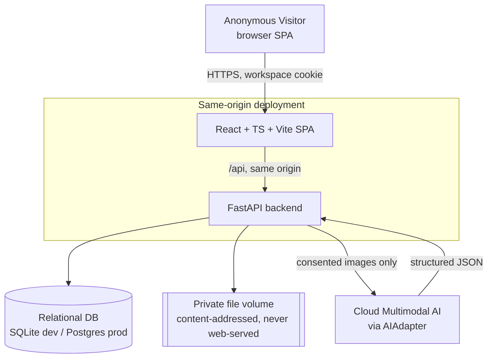
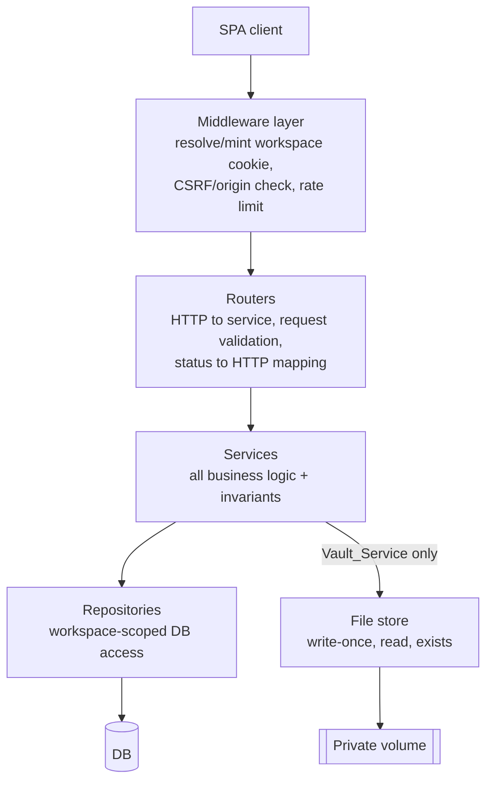
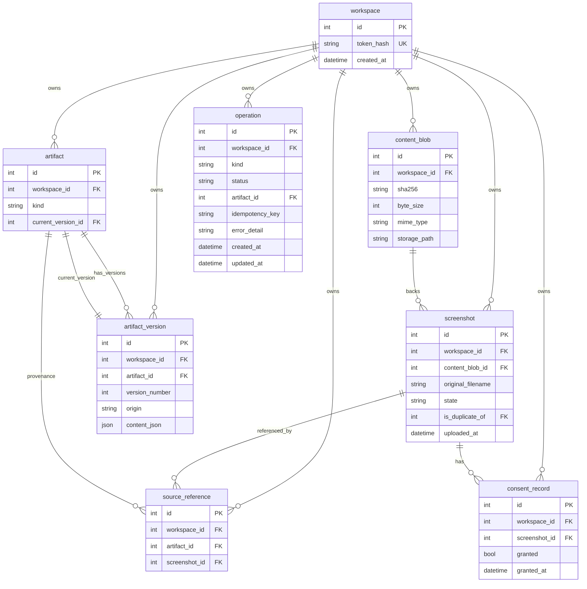

# Design Document

## Overview

Screenshot Graveyard is a purpose-aware, reversible AI screenshot workflow. A visitor uploads previously-captured screenshots; the system stores the originals immutably, helps the visitor understand each screenshot's likely purpose (a classification plus a short honest caption called an Epitaph), transforms selected study screenshots into structured study notes, and lets the visitor non-destructively redo AI work and restore archived originals — all wrapped in a functional Halloween UX where every metaphor maps to a real system state.

This design realizes the smallest maintainable architecture that satisfies every P0 capability and all ten engineering invariants (INV-1…INV-10), and is realistic for one undergraduate developer shipping by a December deadline.

### Design goals and the forces behind them

- **Originals are sacred (INV-1, INV-3, INV-10).** Original bytes are written exactly once, content-addressed, never overwritten, never deleted, and verified by SHA-256 on restore. This is the product's trust anchor and drives the write-once file store and the DB schema.
- **AI work is reversible (INV-5, INV-6, INV-7).** Every artifact keeps an append-only version history with a current-version pointer, and provenance (source references) attaches to the artifact so it survives every redo and edit.
- **Isolation without accounts (ASSUMPTION A1, Req 9, Req 15).** A per-visitor anonymous Workspace is the only security boundary. It is enforced server-side on every query and every file read. There is no login.
- **Small, swappable AI surface (Req 13).** All multimodal AI goes through one `AIAdapter` Protocol returning Pydantic-validated structured output, with a `fake_adapter` test double so the whole system is testable without a real model.
- **No distributed infrastructure.** AI work runs in in-process FastAPI `BackgroundTask`s; rate limiting and quotas are in-process. There is no Celery, Redis, or queue. This is a deliberate simplification appropriate to a solo-dev MVP, with its durability limits documented honestly (see Error Handling and Unresolved Implementation Risks).

### Decision-record convention

Every major decision in this document is annotated with:

- **(a) Why chosen**
- **(b) Simpler alternative considered**
- **(c) Invariants supported**
- **(d) How tested**

### System context



The SPA and API are served from the **same origin** (see Architecture → Security). Image bytes are reachable only through an authorization-checked API endpoint, never through a public storage URL (Req 9.10, 12.2).

## Architecture

### Layered backend

Requests flow strictly downward; each layer has one responsibility and never reaches past the next.



Rules enforced by this layering:

- **Routers never touch repositories or the file store directly.** They translate HTTP to service calls, validate request shape, and map service results/exceptions to HTTP status codes.
- **Services hold all business logic and all invariant enforcement.** Services are where INV-1…INV-10 live.
- **Only `Vault_Service` imports the file store.** No other service may read or write original bytes.
- **Every repository method is workspace-scoped.** The resolved `workspace_id` is a required argument; there is no unscoped query path.

**(a) Why chosen:** a thin, well-separated layering keeps invariant enforcement in one place (services) and keeps the security boundary (workspace scoping) impossible to bypass accidentally. **(b) Simpler alternative:** routers calling repositories directly (fewer files). Rejected because it scatters invariant checks and workspace scoping across the HTTP layer, where they are easy to forget. **(c) Supports:** all invariants, by centralizing enforcement. **(d) Tested:** service-level unit/property tests exercise invariants without HTTP; an architectural test asserts routers do not import repository/file-store modules.

### Technology choices

| Concern | Choice | (a) Why | (b) Simpler alternative | (d) How tested |
|---|---|---|---|---|
| Frontend | React + TypeScript + Vite SPA | Fast dev loop, typed UI, matches Req 10/11 interactivity | Server-rendered templates | Vitest + Testing Library component/interaction tests |
| Backend | Python + FastAPI | First-class async, Pydantic validation, `BackgroundTask` built in | Flask | pytest service + router tests |
| ORM / migrations | SQLAlchemy 2.x + Alembic | Mature, same code for SQLite and Postgres; migrations for prod | Raw SQL | repository tests on SQLite |
| DB | SQLite (dev) → Postgres (prod) | SQLite is zero-setup locally; Postgres is durable/concurrent for prod | SQLite in prod | identical repo tests against both engines in CI (optional) |
| Original bytes | Private content-addressed file volume | Bytes never belong in the DB; content addressing gives dedup + immutability | BLOB column in DB | file-store property tests |
| AI | One `AIAdapter` Protocol + `fake_adapter` | Swap models without touching services (Req 13.4); deterministic tests | Direct SDK calls in services | `fake_adapter` drives all AI-path tests |

### SQLite (dev) → Postgres (prod) justification

**(a) Why chosen:** SQLite needs no server and keeps the solo-dev inner loop trivial; Postgres provides real concurrency, durable writes, and `UNIQUE` constraint enforcement under load in production. SQLAlchemy 2.x + Alembic let the same models and migrations target both. **(b) Simpler alternative:** ship SQLite to production. Rejected because the deployment must survive restarts and concurrent visitors through January 2027 (Req 15.2/15.4), and SQLite's single-writer model plus ephemeral-container risk make it fragile there. **(c) Supports:** INV-3, INV-6, INV-10 (durability and constraint-backed history integrity). **(d) Tested:** repository and property tests run on SQLite in CI; schema is validated against Postgres via Alembic migration in the deploy pipeline.

### Deployment target and persistence

**Target: a solo-dev PaaS with an attached persistent volume and managed Postgres — Fly.io (recommended), or Render/Railway.**

- **DB:** managed Postgres (durable, backed up by the platform).
- **Original bytes:** a **persistent volume** mounted at a fixed path, holding the content-addressed file tree. This volume is **not** web-served and is **not** ephemeral.
- **Explicitly avoided:** writing originals to the container's ephemeral filesystem. Ephemeral storage is wiped on every deploy/restart and would violate INV-1/INV-3/INV-10 (lost originals) and Req 12.2/15.4.

**(a) Why chosen:** Fly.io/Render/Railway all offer a one-command deploy, managed Postgres, and a mountable persistent volume within a hobby budget, matching a solo-dev December timeline. **(b) Simpler alternative:** a single container with local disk. Rejected because local container disk is ephemeral. **(c) Supports:** INV-1, INV-3, INV-6, INV-10. **(d) Tested:** a restart/persistence integration test uploads, restarts the process, and asserts screenshots/artifacts/bytes are still present and checksums still verify (Req 2.3, 12.4).

### Security and the Workspace boundary

The **Workspace is the only security boundary.** There is no user authentication (Req 17.12).

#### Workspace identity (CORRECTION 1)

- On first visit the server mints a **Workspace Identifier** = `secrets.token_urlsafe(32)` (256 bits of entropy, unguessable).
- The server stores **only** `sha256(token)` in `workspace.token_hash` (UNIQUE). The raw token is never stored server-side; it lives **only** in the cookie.
- On each request the middleware reads the cookie, hashes it, looks up the workspace by `token_hash`, and attaches the resolved `workspace_id` to request state. If no cookie/row exists, it mints a new workspace (for endpoints that create one) or resolves to none.
- The client **never** sends a workspace id in any path or body. Any workspace-like id in a path or body is **ignored**; the server-resolved id is authoritative.

**(a) Why chosen:** a 256-bit token is unguessable, and storing only its hash means a DB leak cannot reconstruct live tokens. **(b) Simpler alternative:** store the raw token in the DB and compare directly. Rejected because a DB read would then expose every live workspace. **(c) Supports:** Req 9.9, 12.6, 15.3 (isolation). **(d) Tested:** unit tests assert tokens are 32-byte url-safe, only the hash is persisted, and lookup is by hash; a property test asserts two workspaces never read each other's rows.

#### Cookie configuration

The workspace cookie is set `HttpOnly; Secure; SameSite=Strict; Path=/; Max-Age=~180 days`.

- `HttpOnly` blocks JS access (mitigates token theft via XSS).
- `Secure` restricts it to HTTPS.
- `SameSite=Strict` prevents the cookie riding along on cross-site requests (primary CSRF defense).
- **Same-origin assumption:** the SPA and API share an origin, so `SameSite=Strict` + `HttpOnly` are fully effective and no normal navigation breaks. **If ever deployed cross-origin**, this would require `SameSite=None; Secure` plus explicit CSRF token handling and CORS allow-listing — that cross-origin mode is **explicitly out of scope** for P0.

#### No token-bearing recovery URL (CORRECTION 1)

There is **no** resume/recovery URL that carries the workspace token in P0. A link containing the bearer token could expose the entire workspace if leaked (shared, logged, put in history). Any cross-device or recovery mechanism is **out of scope for P0 — not built, and not deferred as a P2 feature**. The honest consequence (losing the cookie can make a workspace permanently inaccessible) is recorded in Unresolved Implementation Risks with its accepted mitigation.

#### CSRF defense for state-changing requests (CORRECTION 1)

State-changing requests (`POST`/`PUT`/`PATCH`/`DELETE`) must pass the **smallest realistic combination**:

1. **`SameSite=Strict` cookie** — the cookie is not attached to cross-site requests at all.
2. **Server-side Origin/Referer check** — the middleware rejects state-changing requests whose `Origin` (or `Referer` fallback) is not the known app origin (`403`).
3. **Custom-header requirement** — state-changing requests must carry `X-Requested-With: fetch` (or equivalent). Browsers forbid setting custom headers on simple cross-site form submissions, so a cross-site attacker cannot add it.

**(a) Why chosen:** these three layers are cheap, require no stored CSRF token, and defeat the realistic CSRF vectors (form posts, image/iframe tricks) for a same-origin cookie app. **(b) Simpler alternative:** rely on `SameSite` alone. Rejected as single-layer; the Origin check and custom header are near-free defense in depth. A double-submit CSRF token (non-HttpOnly cookie echoed in a header) was considered and deemed unnecessary given same-origin + the three layers above; it is the documented upgrade path if cross-origin is ever needed. **(c) Supports:** Req 9.9 (prevents a forged request from mutating another tab's workspace). **(d) Tested:** router tests assert that a state-changing request with a foreign `Origin` or missing custom header is rejected with `403`.

#### Resource authorization and existence non-disclosure (CORRECTION 1)

**Every** resource is authorized against the **server-resolved** `workspace_id`: image reads, screenshot reads, consent updates, classify, study-note generation, artifact edits, Redo, version reads, compare, and export. The repository layer filters every query by `workspace_id`, and `Vault_Service` filters every file read by the owning workspace.

When a resource exists but belongs to another workspace, the API returns **`404 Not Found`, not `403 Forbidden`**, so the response does not disclose that the resource exists in some other workspace (existence non-disclosure).

**(a) Why chosen:** returning `404` for both "missing" and "not yours" prevents an attacker from probing which ids exist. **(b) Simpler alternative:** `403` for foreign resources. Rejected because it leaks existence. **(c) Supports:** Req 9.9, 9.10, 12.6. **(d) Tested:** property test — for any resource created in workspace A, every read/mutate attempt from workspace B returns `404` and leaves A's data unchanged.

### Async execution model

- **AI endpoints** (`classify`, `study-notes`, `redo`) return **`202 Accepted` + an `operationId`** and run the AI work in an in-process FastAPI `BackgroundTask`. The client polls `GET /api/operations/{id}` for status (`pending` → `successful`/`failed`/`uncertain`).
- **Vault operations** (upload, archive, restore) are **synchronous and transactional** — they are fast, local, and must be atomic.

**In-process `BackgroundTask`s are NOT durable across process restarts.** This is stated plainly here and handled by the startup sweep described in Error Handling (CORRECTION 4). **(a) Why chosen:** zero extra infrastructure, trivially testable with the fake adapter, adequate for solo-dev traffic. **(b) Simpler alternative considered:** run AI synchronously inside the request. Rejected because multimodal calls can take many seconds and would tie up the request/timeout. **(c) Supports:** INV-4 (a crashed background task never mutates sources; recovery marks it failed). **(d) Tested:** tests simulate a crash mid-operation and assert the sweep marks it `failed` and leaves sources intact.

### Rate limiting and quotas

All in-process (no distributed limiter):

- **Token-bucket rate limiter** per workspace in the middleware.
- **Per-workspace DB quota counters**: max stored screenshots, max AI calls.
- **Max files per batch** on upload.
- **Payload size cap** → `413 Payload Too Large`, enforced before buffering the whole body (see CORRECTION 3 size gate).

**(a) Why chosen:** protects a public hobby deployment from accidental or abusive load without a distributed system. **(b) Simpler alternative:** no limits. Rejected because the deployment is public through Jan 2027. **(c) Supports:** INV-1/INV-4 indirectly (prevents resource exhaustion from corrupting operations). **(d) Tested:** unit tests on the token bucket; router test asserts `413` past the cap and `429` past the rate limit.

## Components and Interfaces

### Middleware layer

- **Workspace middleware:** resolve cookie → `sha256` → look up / mint workspace → attach `workspace_id` to request state; set cookie on mint.
- **CSRF/Origin middleware:** enforce the three-layer CSRF defense on state-changing methods.
- **Rate-limit middleware:** token-bucket per workspace.

### Routers (HTTP ↔ service)

Routers validate request shape (Pydantic request models), call a service with the resolved `workspace_id`, and map results/exceptions to HTTP status. Routers never import repositories or the file store. Status mapping:

| Service outcome | HTTP |
|---|---|
| success (read) | `200` |
| resource created (new version/workspace) | `201` |
| async accepted | `202` |
| mixed batch results | `207 Multi-Status` |
| validation error | `400` |
| consent required | `403` |
| not found / foreign workspace | `404` |
| payload too large | `413` |
| rate limited | `429` |

### Services (all business logic + invariants)

- **`Vault_Service`** (INV-1, INV-2, INV-3, INV-4, INV-10): upload validation, write-once storage, checksums, dedup, archive/restore with SHA-256 verification. The **only** importer of the file store.
- **`Classification_Service`** (INV-1, INV-4): one AI call producing classification **and** Epitaph; schema validation; atomic co-persistence (CORRECTION 5).
- **`Study_Note_Service`** (INV-1, INV-5, INV-6, INV-7): selection validation (1–12; warn outside 4–8), structured note generation, versioning, references, Markdown export.
- **`Artifact_Service`** (INV-1, INV-5, INV-6, INV-7): version history, current-version pointer, redo, edit, compare, source references.
- **`Consent_Service`**: records/reads per-screenshot consent; gates all AI paths.
- **`AI_Adapter`** (INV-4, Req 13): the `AIAdapter` Protocol + real + fake implementations.
- **`Delivery_Service`** — **P1 INTERFACE STUB ONLY** (INV-8, INV-9): method signatures and the external-write safety contract are defined, but there is **no implementation, no OAuth, no third-party infrastructure in P0** (Req 8 note, Req 16.3, Req 14.7).

### `AIAdapter` Protocol and the fake adapter (Req 13)

```python
class ClassificationResult(BaseModel):
    category: Category          # one of six fixed categories
    confidence: float
    uncertain: bool
    epitaph: EpitaphPayload     # produced in the SAME call (Req 5.1)

class StudyNoteResult(BaseModel):
    topic: str
    main_concepts: list[str]
    extracted_code: list[str]
    code_explanations: list[str]
    pitfalls: list[str]
    uncertain_content: list[str]
    references: list[int]       # source Screenshot IDs

class AIAdapter(Protocol):
    def classify_and_epitaph(self, image_bytes: bytes, mime: str) -> ClassificationResult: ...
    def study_note(self, images: list[tuple[int, bytes, str]]) -> StudyNoteResult: ...
```

- All outputs are **Pydantic-validated** before persistence (Req 13.2/13.3). A validation failure raises, and the operation is marked `failed`/`uncertain` without touching sources (INV-4).
- The adapter enforces a **timeout** (CORRECTION 4); on timeout the operation is `failed`/`uncertain`.
- The **`fake_adapter`** returns deterministic, schema-valid output (and can be told to produce invalid output, timeouts, or uncertainty) so every AI-path test runs without a real model and without network/cost.

**(a) Why chosen:** one Protocol isolates the model so services never change when the model does (Req 13.4); the fake makes the system fully testable. **(b) Simpler alternative:** call the model SDK directly in services. Rejected — couples business logic to a vendor and makes tests require a live model. **(c) Supports:** INV-4, Req 13. **(d) Tested:** services are tested against the fake; a contract test asserts the real adapter's output validates against the same Pydantic models.

### File store interface (CORRECTION 2)

Three operations only — **no delete, no overwrite**:

```python
class FileStore(Protocol):
    def write_once(self, workspace_id: int, sha256: str, data: bytes) -> str:
        """Exclusive, concurrency-safe publish. Returns storage_path.
        If the content-addressed destination already exists, treat as success
        WITHOUT replacing existing bytes."""
    def read(self, storage_path: str) -> bytes: ...
    def exists(self, storage_path: str) -> bool: ...
```

**Publication algorithm (truly immutable creation):**

1. Compute `sha256` of the bytes; derive the content-addressed final path (e.g. `…/<ws>/<ab>/<cd>/<sha256>`).
2. Write bytes to a **unique temp file** on the same volume, using a **distinct, recognizable naming scheme in a dedicated temp location** — a reserved `.tmp/` subdirectory (or a reserved temp suffix) that can **never collide with or be mistaken for a content-addressed published original**; `flush()` then `os.fsync()`.
3. **Publish by exclusive create**: `os.link(temp, final)` (or `open(final, O_CREAT|O_EXCL)`), which **fails if `final` already exists**.
   - If it fails because the destination exists → identical content is already stored → **success without replacing** the existing bytes; delete the temp file.
   - If it succeeds → set the published file **read-only (`0o444`)**.
4. `try/finally`: for **in-process** exceptions and the link-exists path, the temp file is removed. **A Python `try/finally` guarantees temp cleanup only for in-process exceptions — NOT for a hard process crash, power loss, or `SIGKILL`.** Such a crash can leave an **orphan temp file** behind; this is handled by the crash-tolerant temp scheme and the optional sweep below, and is harmless by construction.

**Required safety property (crash tolerance):** temp-file handling must **tolerate crashes WITHOUT ever deleting or modifying a published original.** Because temp files live under the reserved `.tmp/` location (or reserved suffix), they can never be confused with a content-addressed published blob. An **optional, safe, idempotent cleanup/sweep** may remove **ONLY stale temp files** (old entries under `.tmp/`); it **never touches anything under the published content-addressed paths**. Published originals are set **read-only (`0o444`)** and are never modified or deleted by any cleanup.

**Guarantees:** existing original bytes are **never** replaced (INV-1); concurrent identical uploads cannot corrupt a file (the exclusive-create loser keeps the already-published bytes; both uploads succeed logically); SHA-256 is verified at restore (INV-3) and optionally re-hashed after write; temp cleanup is **best-effort and crash-safe** — a crash leaves at most a harmless orphan temp file that the sweep (never the published tree) may later remove.

**Failure/crash semantics:** **publish by exclusive-create first (idempotent by content), DB commit second.** A crash at any point leaves at most **(a) an orphan temp file** under `.tmp/` and/or **(b) an orphan published blob** that a later identical upload reuses idempotently — **never a lost, modified, or deleted original** (INV-1, INV-3, INV-10). Orphan cleanup is low-priority and safe to leave; when run, it removes only stale temp files and unreferenced blobs it is explicitly allowed to touch, never a published original relied upon by a DB row.

**(a) Why chosen:** exclusive create is the OS-level guarantee that two writers can't both "win" a path, and content addressing makes the write idempotent. **(b) Simpler alternative:** write then `os.replace()`/rename. Rejected — rename overwrites an existing destination, which could replace good bytes and violates INV-1. **(c) Supports:** INV-1, INV-3, INV-10. **(d) Tested:** property/integration tests for N concurrent identical uploads (one blob, all records succeed, bytes intact); interrupted write (no bytes published at the final path; in-process cleanup removes the temp file, and a simulated hard crash leaves at most a harmless orphan temp file under `.tmp/`); a cleanup/sweep test that removes only stale temp files and **never** touches any published content-addressed original; and attempt-to-replace-existing (exclusive create prevents overwrite; bytes unchanged).

### Image validation policy (CORRECTION 3)

One ordered acceptance policy; **the extension and declared MIME are hints only and are never a sole reject reason**:

1. **Size gate first (before decode):** reject files over **15 MB** (Req 1.5 / A5) using `Content-Length` and streaming, so an arbitrarily large payload is **never fully buffered** → `413`.
2. **Declared extension** = hint only.
3. **Declared MIME** = hint only.
4. **File signature (magic bytes)** = authoritative format gate: must be PNG, JPEG, or WebP (Req 1.3).
5. **Successful decode** with Pillow confirming a real, decodable image (Req 1.2/1.4); `Image.verify()` then a load.
6. **Dimension / megapixel cap** to stop decompression bombs: **max dimension 12000 px and ≈40 MP** cap, enforced via Pillow's `MAX_IMAGE_PIXELS` guard plus an explicit dimension check. 40 MP ≈ a 7000×5700 image, comfortably above legitimate screenshots while blocking bombs.

**Authoritative accept decision = signature + successful decode + dimension/pixel cap + size.** It is **independent of the declared extension/MIME** (Req 1.2 is satisfied by determining the supported image type from actual content, not the declared format). The declared extension/MIME is **never** the sole reason to reject a file.

**Mismatched declared metadata (explicit behavior):** when the declared filename extension or declared MIME type disagrees with the **true detected format** but the bytes are a **valid, decodable, supported** image, the file is **ACCEPTED**. The system **records and uses the detected true format** (persisted in `content_blob.mime_type` from the signature/decode result, not from the declared value) and MAY surface a **non-blocking warning** noting the mismatch. The declared extension/MIME is never used to reject.

Malformed/unsupported input is rejected **safely** (no crash) with a descriptive error that **names the file** (Req 1.4/1.5). A rejection is driven by the content-authoritative checks (bad/absent signature, failed decode, pixel-cap, or size), never by the declared extension/MIME alone.

**(a) Why chosen:** trusting content (signature + decode) rather than the filename is the only safe way to admit images, and size-before-decode plus a pixel cap defends against decompression bombs. **(b) Simpler alternative:** trust the extension/MIME. Rejected — forgeable and self-contradictory with Req 1.3. **(c) Supports:** Req 1.2–1.6 (and INV-1, since rejected junk never becomes a stored original). **(d) Tested:** property test — accept decision tracks signature+decode+caps+size and is invariant to the declared extension/MIME; a valid image carrying a mismatched declared extension/MIME is accepted and the persisted format is the detected true format (not the declared one); a decompression-bomb test (small file, huge declared dimensions) is rejected by the pixel cap; a mixed batch stores valid and reports invalid per file.

### Frontend components (Req 10, 11)

Each Halloween metaphor maps to a real state and is accessible:

| Metaphor | Real state / action | Accessibility |
|---|---|---|
| **Ghost** | screenshot `state=active` with no analysis yet (pending) | text label "Pending", not color-only |
| **The Crypt** | the set of `state=archived` screenshots | list view, keyboard navigable |
| **Revive** | start a transformation (classify / study note) | button with accessible name "Revive (start AI analysis)" |
| **Resurrection** | restore an archived original **or** AI Redo | memorable but reduced-motion-aware animation |
| **Safe Burial** | archive (never deletes) | confirm dialog states bytes are retained |
| **Epitaph** | the generated/edited caption | editable text field with label |

Accessibility implementation: responsive layouts (mobile/tablet/desktop), contrast-checked typography, `prefers-reduced-motion` **plus** an in-app reduced-motion toggle, full keyboard operability with accessible names, and operation status conveyed via **text + non-color cues** in addition to color (Req 11).

**(a) Why chosen:** tying each metaphor to a concrete state keeps the theme functional, not decorative (Req 10.6). **(b) Simpler alternative:** decorative-only theming. Rejected by Req 10. **(c) Supports:** Req 10, 11. **(d) Tested:** Vitest/Testing Library tests assert each metaphor renders the correct underlying state, reduced-motion disables animation, controls have accessible names, and status text is present without relying on color.

## Data Models

### Entity-relationship diagram



### Tables (SQLAlchemy 2.x)

- **`workspace`** `(id, token_hash UNIQUE, created_at)` — only `sha256(token)` stored.
- **`content_blob`** `(id, workspace_id, sha256, byte_size, mime_type, storage_path, UNIQUE(workspace_id, sha256))` — one row per unique content within a workspace (dedup, A3).
- **`screenshot`** `(id PK = Screenshot ID, stable for life; workspace_id, content_blob_id, original_filename, state ∈ {active, archived}, is_duplicate_of NULL, uploaded_at)`.
- **`artifact`** `(id, workspace_id, kind ∈ {classification, epitaph, study_note}, current_version_id)` — the current-version pointer.
- **`artifact_version`** `(id, workspace_id, artifact_id, version_number, origin ∈ {ai_generate, ai_redo, manual_edit}, content_json, UNIQUE(artifact_id, version_number))` — **INSERT-ONLY; there is no UPDATE path to `content_json`.**
- **`source_reference`** `(id, workspace_id, artifact_id, screenshot_id, UNIQUE(artifact_id, screenshot_id))` — provenance attaches to the **artifact**, so it survives every version/redo (INV-7).
- **`consent_record`** `(id, workspace_id, screenshot_id, granted, granted_at, UNIQUE(workspace_id, screenshot_id))`.
- **`operation`** `(id, workspace_id, kind, status ∈ {pending, successful, failed, uncertain}, artifact_id NULL, idempotency_key NULL [P1], error_detail NULL, created_at, updated_at)`.

**Every non-`workspace` table carries `workspace_id` as a FK and is indexed on `workspace_id`.** All queries and file reads are workspace-scoped (Req 12.6, 9.9).

### `content_json` payload shapes

- **classification:** `{category, confidence, uncertain, user_overridden}`
- **epitaph:** `{text, visible_facts, inferred_intent, uncertain, user_overridden}`
- **study_note:** `{topic, main_concepts[], extracted_code[], code_explanations[], pitfalls[], uncertain_content[], references[screenshot_id]}`

### Why provenance attaches to the artifact (not the version)

**(a) Why chosen:** a redo or edit creates a new **version** but the artifact's source screenshots don't change, so attaching `source_reference` to the **artifact** means provenance survives every version automatically (INV-7). **(b) Simpler alternative:** attach references to each version. Rejected — it duplicates rows on every redo and risks a version losing its provenance. **(c) Supports:** INV-7, Req 6.7, 7.2, 12.3. **(d) Tested:** property test — after any sequence of redos/edits, every artifact still references all its source Screenshot IDs.

### Why append-only versions with a current pointer

**(a) Why chosen:** INSERT-only history plus `UNIQUE(artifact_id, version_number)` makes it structurally impossible to overwrite or lose a version; the `current_version_id` pointer gives O(1) "current" without mutating history. **(b) Simpler alternative:** a single mutable `content_json` per artifact. Rejected — it cannot satisfy INV-5/INV-6 (no prior versions). **(c) Supports:** INV-5, INV-6. **(d) Tested:** property test (Property 15) — any redo/edit sequence leaves all prior versions retrievable and version numbers strictly increasing with no gaps or duplicates; and, grouped in the same property, concurrent Redo + Manual Edit (and Redo + Redo) on the same artifact **both complete** via bounded retry, yielding distinct version numbers, all priors retained, and a valid `current_version_id`.

## Correctness Properties

*A property is a characteristic or behavior that should hold true across all valid executions of a system — essentially, a formal statement about what the system should do. Properties serve as the bridge between human-readable specifications and machine-verifiable correctness guarantees.*

The prework above classified every acceptance criterion and consolidated redundant ones. The properties below are the deduplicated set. Each is universally quantified and tagged with the requirements and invariants it validates. Property-based tests run **≥100 iterations** (Hypothesis on the backend; fast-check/Vitest on the frontend).

### Property 1: Source immutability under any operation

*For any* stored screenshot and *any* sequence of subsequent operations (archive, restore, classify, epitaph edit, study-note generation, AI Redo, manual edit, or an operation that fails at any point), the original image bytes and their persisted SHA-256 checksum remain byte-for-byte unchanged and the published file remains read-only.

**Validates: Requirements 2.1, 3.6, 4.3, 5.6, 6.12, 7.1, 8.1, 8.6, 13.3, 14.5** (INV-1, INV-4)

### Property 2: Archive/restore round-trip integrity

*For any* stored screenshot, archiving (Safe Burial) and then restoring (Resurrection) returns the screenshot to the active state and yields bytes whose SHA-256 equals the originally stored checksum.

**Validates: Requirements 3.1, 3.2, 3.3, 14.2** (INV-2, INV-3, INV-10)

### Property 3: Persisted checksum equals content hash

*For any* uploaded image that passes validation, the SHA-256 persisted alongside its metadata equals the SHA-256 of the exact bytes stored, and this stored checksum is the one used for restore verification.

**Validates: Requirements 2.2, 12.5** (INV-3)

### Property 4: Content-addressed deduplication within a workspace

*For any* set of uploads within one workspace, uploads sharing identical content produce exactly one `content_blob` (one stored byte sequence) while producing a distinct `screenshot` record per upload that references the shared content.

**Validates: Requirements 2.4** (INV-1)

### Property 5: Consolidated image acceptance policy (extension-independent)

*For any* uploaded file, the accept decision equals (valid PNG/JPEG/WebP **signature**) AND (Pillow **decodes** it as a real image) AND (within the **dimension/≈40 MP cap**) AND (**≤ 15 MB**), and this decision is **independent** of the declared filename extension and declared MIME type (the declared value is never the sole reject reason); for any valid, decodable, supported image whose declared extension/MIME disagrees with its true detected format, the file is **accepted** and the persisted format is the **detected true format** rather than the declared value; rejected files are handled safely (no crash) with a descriptive error that names the file, and oversize files are rejected before the body is fully buffered.

**Validates: Requirements 1.2, 1.3, 1.4, 1.5** (INV-1) *(CORRECTION 3)*

### Property 6: Decompression-bomb rejection

*For any* input whose declared/encoded dimensions exceed the pixel cap (even when the file is small on disk), validation rejects it via the megapixel/dimension guard without attempting a full decode into memory.

**Validates: Requirements 1.3, 1.4** (INV-1) *(CORRECTION 3)*

### Property 7: Mixed-batch partial success

*For any* batch containing an arbitrary mix of valid and invalid files, every valid file is stored and every invalid file is reported with a per-file error, and the batch is never aborted as a whole (HTTP 207).

**Validates: Requirements 1.6**

### Property 8: Stable Screenshot ID

*For any* stored screenshot and *any* subsequent sequence of operations, its Screenshot ID never changes.

**Validates: Requirements 1.7**

### Property 9: Exclusive, concurrency-safe write-once publication

*For any* number of concurrent uploads of identical content, exactly one set of bytes is published at the content-addressed path, every upload record is created successfully, the published bytes are never replaced, and no temp file remains after completion or failure.

**Validates: Requirements 2.1, 2.4** (INV-1, INV-3, INV-10) *(CORRECTION 2)*

### Property 10: Interrupted write leaves no published artifact, and cleanup is crash-safe

*For any* upload interrupted after the temp write but before exclusive publication, no bytes are ever published at the final content-addressed path. For an **in-process** interruption the temp file is removed via `try/finally`; for a **hard crash / power loss / `SIGKILL`** (not covered by `try/finally`) at most a harmless **orphan temp file** under the reserved `.tmp/` location remains. In all cases, temp cleanup is **best-effort and crash-safe** and **NEVER deletes or modifies a published original**: for any state of the temp area, running the optional sweep removes only stale temp files and leaves every published content-addressed original byte-for-byte unchanged.

**Validates: Requirements 2.1** (INV-1, INV-3, INV-10) *(CORRECTION 3)*

### Property 11: Exclusive create never overwrites existing bytes

*For any* attempt to publish content whose content-addressed path already exists, the operation succeeds logically without replacing the existing bytes, which remain unchanged.

**Validates: Requirements 2.1** (INV-1, INV-10) *(CORRECTION 2)*

### Property 12: AI output schema validation gate

*For any* output returned by the AI_Adapter, the output is persisted only if it conforms to the defined Pydantic schema (classification into exactly one of the six fixed categories; study note with all required sections); non-conforming output is rejected and never persisted.

**Validates: Requirements 4.1, 4.2, 13.2, 13.3** (INV-4)

### Property 13: Uncertainty is represented, never forced to success

*For any* AI result expressing low confidence or an uncertain reading, the stored output represents the uncertainty (uncertain flag, Unknown/Needs Review category, uncertain Epitaph text, or Uncertain/ambiguous content entry) and the corresponding operation status is `uncertain` rather than `successful`.

**Validates: Requirements 4.4, 5.3, 6.6, 8.3** (INV-4)

### Property 14: Atomic co-persistence of classification and Epitaph from one AI call

*For any* classify operation, exactly one AI_Adapter call is made, and its classification artifact version and Epitaph artifact version (plus their source references and current-version repoints and the operation→successful transition) are committed in a single transaction: either both are persisted and the operation is `successful`, or neither is persisted and the operation is `failed`/`uncertain`. A classification is never persisted without its Epitaph, nor vice versa.

**Validates: Requirements 4.2, 5.1** (INV-1, INV-4) *(CORRECTION 5)*

### Property 15: Append-only versioning with all priors retained (incl. concurrent completion)

*For any* artifact and *any* sequence of AI Redos and saved Manual Edits — **including operations issued concurrently on the same artifact** — each action inserts a new `artifact_version` (never mutating a prior version's `content_json`), version numbers are strictly increasing with no gaps or duplicates, the `current_version_id` points at a newest valid version, and every previously saved version — including any manually edited version preserved across a later AI Redo — remains retrievable.

Additionally, for *any* two operations issued **concurrently** on the same artifact (AI Redo + Manual Edit, or AI Redo + AI Redo), **both operations COMPLETE successfully** via the bounded retry-on-conflict path (not merely "duplicates are rejected"): the final retained version count increases by the number of operations, all resulting version numbers are **distinct**, **all prior versions remain retrievable**, and `current_version_id` is **valid** and points at one of the committed versions.

**Validates: Requirements 4.5, 5.5, 6.9, 6.10, 7.3, 7.4, 7.5, 7.6, 8.6, 14.3** (INV-5, INV-6) *(CORRECTION 2: concurrent completion)*

### Property 16: Provenance survives every version

*For any* artifact generated from a set of source screenshots, the artifact retains a `source_reference` to every source Screenshot ID, and this reference set is unchanged by any subsequent Redo or Manual Edit.

**Validates: Requirements 6.7, 7.2, 12.3, 14.4** (INV-7)

### Property 17: Version comparison

*For any* artifact with at least two retained versions, the system can retrieve any two versions and produce a comparison between them.

**Validates: Requirements 7.8** (INV-6)

### Property 18: Study-note structure completeness

*For any* generated study note, the stored content contains all required sections: Topic, Main concepts, Extracted code, Code explanations, Important pitfalls, Uncertain/ambiguous content, and References to source Screenshot IDs.

**Validates: Requirements 6.4**

### Property 19: Faithful code preservation

*For any* code the AI_Adapter reads from source screenshots, the persisted `extracted_code` preserves the exact characters including indentation and symbols (no normalization or re-formatting applied by our pipeline).

**Validates: Requirements 6.5**

### Property 20: Study-note selection count policy

*For any* selection count c, generation is accepted when 1 ≤ c ≤ 12 and rejected with a descriptive error otherwise, and a non-blocking warning is present exactly when c < 4 or c > 8 (generation still proceeds).

**Validates: Requirements 6.2, 6.3**

### Property 21: Markdown export reflects the selected retained version

*For any* retained version of a study note, export produces valid Markdown reflecting that version's content; when no version is specified, export defaults to the current version.

**Validates: Requirements 6.11**

### Property 22: Operation status lifecycle

*For any* transformation operation, its status is always exactly one of {pending, successful, failed, uncertain}, is observable via `GET /api/operations/{id}`, and transitions to `successful` only after its persistence transaction commits.

**Validates: Requirements 8.2, 8.3** (INV-4)

### Property 23: Consent gate for AI processing

*For any* screenshot without recorded consent, any AI operation (classify, study note, redo) is blocked (403) and the AI_Adapter is never invoked, while non-AI vault operations (store, archive, restore) still succeed and leave the bytes intact.

**Validates: Requirements 9.2, 9.4** (INV-1)

### Property 24: Workspace isolation and existence non-disclosure

*For any* resource created in workspace A, every read or mutation attempt carrying workspace B's resolved identity returns `404 Not Found` (never `403`, never the data) and leaves A's data unchanged; this holds for screenshots, image bytes, consent, artifacts, versions, compare, and export.

**Validates: Requirements 9.9, 9.10, 12.6** (INV-1) *(CORRECTION 1)*

### Property 25: No image bytes or credentials in logs

*For any* operation, the application logs contain neither original image bytes nor credential-like content extracted from screenshots.

**Validates: Requirements 9.8**

### Property 26: Halloween metaphors map to real state

*For any* set of screenshots in arbitrary states, the Ghost representation appears exactly for pending screenshots and The Crypt contains exactly the archived subset, so each metaphor faithfully reflects the real underlying state.

**Validates: Requirements 10.1, 10.2, 10.5, 10.6** (INV-10)

### Property 27: External write never reported successful without evidence (P1-conditional)

*For any* external write, the Delivery_Service reports success only when it holds verified evidence that the destination accepted the content. **This property is P1-conditional and is exercised only when the external integration is enabled (Req 14.7); it is not required for P0 completion.**

**Validates: Requirements 8.4, 14.6, 16.3** (INV-8)

### Property 28: Uncertain external retries do not duplicate (P1-conditional)

*For any* external write that returns uncertain followed by a user retry, the Delivery_Service does not create a blind duplicate external artifact. **P1-conditional; exercised only when the external integration is enabled (Req 14.7); not required for P0.**

**Validates: Requirements 8.5, 14.6, 16.3** (INV-9)

## Error Handling

### Request-layer errors (synchronous)

Routers map service exceptions to HTTP status: `400` (invalid request / study-note count out of 1–12), `403` (consent required for AI; CSRF/Origin failure), `404` (missing or foreign-workspace resource — existence non-disclosure), `413` (payload over cap), `429` (rate limited), `207` (mixed batch). Every error carries a descriptive, user-facing message; upload errors name the offending file (Req 1.4/1.5).

### Vault operation failures (synchronous, transactional)

- **Upload validation failure:** per-file error in the 207 result; valid files in the same batch still stored (Property 7).
- **Write-once publication:** publish file first by exclusive-create (idempotent by content), DB commit second. Temp files are cleaned up via `try/finally` for **in-process** failures only; a **hard crash/power loss/`SIGKILL`** is **not** covered by `try/finally` and may leave an orphan temp file. Temp files live under a reserved `.tmp/` location (or reserved suffix) so they can never be mistaken for a published original; an optional, idempotent sweep removes **only** stale temp files and **never** touches the published content-addressed tree (originals stay read-only). A crash between publish and commit leaves at most an orphan temp file and/or an orphan published blob that a later identical upload reuses idempotently — **never a lost, modified, or deleted original** (INV-1, INV-3, INV-10; CORRECTION 3).
- **Restore checksum mismatch:** report restore `failed` and retain the archived original bytes unchanged (Req 3.4; INV-3, INV-4).
- **Any archive/restore failure:** source bytes left intact (INV-4, Property 1).

### Background operation recovery and concurrency (CORRECTION 4)

In-process FastAPI `BackgroundTask`s are **not durable across process restarts.** This is handled explicitly, with no Celery/Redis/distributed system:

- **Stale pending sweep:** on startup, and periodically, any `operation` in `pending` whose `updated_at`/heartbeat is older than a threshold is marked `failed` with a descriptive `error_detail`. Sources are untouched (INV-4).
- **Crash mid-AI:** the operation is left `pending` and recovered to `failed` by the sweep. No partial `artifact_version` exists because success persistence is a single atomic transaction.
- **AI timeout:** the adapter enforces a timeout; on timeout the operation becomes `failed` or `uncertain`, sources untouched.
- **Error after a valid AI response but before commit:** the entire persistence — insert artifact_version(s) + source_reference(s) + repoint `current_version_id` + operation→`successful` — is **one transaction**. If commit fails it rolls back and the operation is marked `failed`/retryable. The operation is **never** reported `successful` unless the commit succeeded (no misleading partial success; Property 22).
- **Concurrent Redo / Manual Edit — completion, not just duplicate rejection:** `UNIQUE(artifact_id, version_number)` by itself only **prevents duplicate version numbers**; it does **not**, on its own, make two concurrent completions succeed. The losing transaction of a race must **RETRY**, and the retry is what guarantees completion. The semantics are:
  - Each attempt runs in its **own fresh transaction**; the next `version_number` is read **inside** that transaction (e.g. `max(version_number)+1` for the artifact).
  - If `UNIQUE(artifact_id, version_number)` rejects the insert because a concurrent writer already took that number, the losing writer **recomputes the next `version_number` in a new transaction and retries**, up to a **bounded retry count** (after which it surfaces a transient-conflict error for the client to retry).
  - **Guaranteed outcome:** concurrent operations on the same artifact — AI Redo + Manual Edit, or Redo + Redo — **both eventually COMMIT as separate versions**. The final version count increases by the number of operations, every version number is **distinct and monotonically increasing (gapless under serialized commits)**, **all prior versions are retained** and remain retrievable, and `current_version_id` ends on **one well-defined, valid version** (the last committer's). No operation is lost.
  - Chosen approach: optimistic insert + unique-constraint + **retry-until-success within bounded attempts, each in its own transaction** (simpler than per-artifact locking and sufficient for in-process concurrency).
- **Append-only protection:** there is no UPDATE path to `content_json`; INSERT-only plus the unique constraint and transactions guarantee history integrity (INV-5/INV-6, Property 15).
- **Safe retry:** a retry creates a **new** operation and, on success, a **new** version; all prior versions remain (INV-5/INV-6). External-write idempotency stays **P1-only**.

### AI schema-validation failures

Non-conforming adapter output is rejected before persistence; the operation is marked `failed`/`uncertain`; sources are preserved (Req 13.3; Properties 12, 1).

## Testing Strategy

PBT **is appropriate** for this feature: the core guarantees (immutability, round-trip integrity, append-only versioning, provenance, dedup, isolation, the acceptance policy, atomic co-persistence) are universal statements over large input spaces and are testable against pure-ish service logic with the `fake_adapter` and a temp file store. UI, deployment, and external-service behavior use example/integration/smoke tests instead.

### Dual approach

- **Property-based tests (Hypothesis, backend):** Properties 1–26 above (Properties 27–28 are **P1-conditional** and not required for P0 per Req 14.7). Each PBT runs **≥100 iterations**. Each test is tagged:
  `# Feature: screenshot-graveyard, Property {n}: {property_text}`
  We use **Hypothesis** (do not hand-roll PBT). Image inputs are generated with Hypothesis strategies plus small synthetic PNG/JPEG/WebP byte fixtures; the `fake_adapter` is driven to produce valid/invalid/uncertain/timeout outputs. File-store concurrency properties (9–11) use real temp files on one volume with threaded/parallel publication. Versioning concurrency is covered **within Property 15** (not a separate suite): a threaded/parallel case issues an AI Redo and a Manual Edit (and separately two Redos) on the same artifact and asserts **both complete** — final version count increased by the number of operations, distinct version numbers, all prior versions retrievable, and a valid `current_version_id`.
- **Unit / example tests (pytest + Vitest/Testing Library):** duplicate indicator render (2.5), no-delete route (2.6), no auto-task (4.6), advisory-copy wording (4.7, 9.5–9.7, 9.12, 9.13, 13.5), manual selection required / no clustering (6.1), reopen original (6.8), redo instruction override (7.7), restore-from-artifact (7.9), privacy warning before AI (9.1, 9.3), no-credential-store (9.11), single AIAdapter dependency and model swap (13.1, 13.4), single-command suite (14.1), frontend metaphor/state mapping, reduced-motion toggle, keyboard/accessible names, non-color status cues, responsive layouts, contrast (10.3–10.4, 11.1–11.5).
- **Edge-case tests:** checksum mismatch on restore (3.4), count 0/13 rejection and 1/12 acceptance (6.3), decompression bomb (Property 6), oversize 413 (1.5).
- **Integration tests:** restart persistence and workspace-scoped availability (2.3, 12.1, 12.4), bytes-on-volume-not-in-DB and not web-served (12.2, 9.10).
- **Smoke tests:** public URL reachable and workspace isolation in effect on the deployment (15.*).

### Recommended libraries

- **Backend:** Hypothesis (PBT) + pytest. Pydantic for schema validation. Pillow for image decode/caps.
- **Frontend:** Vitest + Testing Library (+ fast-check for any frontend property tests, e.g., metaphor/state mapping).

### P1-conditional note

Per Req 14.7, the external-write properties (27, 28; INV-8/INV-9) are exercised **only when the P1 external integration is enabled**. The round-trip, reversibility, provenance, and source-safety properties (2, 15, 16, 1) remain mandatory for P0.

## Requirements-to-Design Traceability Matrix

| Requirement | Design element(s) | Property / Test |
|---|---|---|
| 1.1 | Vault_Service upload, router 207 | P7 |
| 1.2–1.4 | Image validation policy (signature+decode) | P5, P6 |
| 1.5 | Size gate before decode, 413 | P5, edge |
| 1.6 | Mixed-batch partial success, 207 | P7 |
| 1.7 | `screenshot.id` stable PK | P8 |
| 2.1 | Write-once file store, read-only publish | P1, P9, P10, P11 |
| 2.2 | SHA-256 persisted | P3 |
| 2.3 | Persistent volume + DB; restart | Integration |
| 2.4 | `content_blob` UNIQUE(ws, sha256), dedup | P4, P9 |
| 2.5 | `is_duplicate_of`, UI indicator | Example |
| 2.6 | No delete endpoint; file store no-delete | Example |
| 3.1–3.3 | Archive/restore + SHA-256 verify | P2 |
| 3.4 | Restore mismatch → failed, bytes retained | Edge, P1 |
| 3.5–3.6 | Archived bytes retained; failure safety | P1, P2 |
| 4.1 | Six-category enum | P12 |
| 4.2 | Pydantic schema gate | P12, P14 |
| 4.3 | Schema fail → failed, source safe | P1, P12 |
| 4.4 | Uncertainty representation | P13 |
| 4.5 | Override → new version | P15 |
| 4.6 | No auto-task | Example |
| 4.7 | Advisory wording | Example |
| 5.1 | One AI call, atomic co-persist | P14 |
| 5.2, 5.4 | Epitaph schema visible_facts/inferred_intent | Example |
| 5.3 | Uncertain Epitaph | P13 |
| 5.5 | Epitaph edit → new version | P15 |
| 5.6 | Edit never touches bytes | P1 |
| 6.1 | Manual selection required | Example |
| 6.2, 6.3 | Count policy (warn/reject) | P20 |
| 6.4 | Study-note structure | P18 |
| 6.5 | Faithful code | P19 |
| 6.6 | Uncertain section | P13 |
| 6.7 | source_reference on artifact | P16 |
| 6.8 | Reopen original | Example |
| 6.9, 6.10 | Append-only versions | P15 |
| 6.11 | Markdown export | P21 |
| 6.12 | No byte mutation | P1 |
| 7.1 | Immutable inputs | P1 |
| 7.2 | Source-artifact link | P16 |
| 7.3–7.6 | Versioning | P15 |
| 7.7 | Redo instruction override | Example |
| 7.8 | Compare | P17 |
| 7.9 | Restore from artifact | Example |
| 8.1 | AI failure source safety | P1 |
| 8.2, 8.3 | Operation status lifecycle | P22 |
| 8.4, 8.5 | Delivery_Service stub contract (P1) | P27, P28 (P1) |
| 8.6 | Failure leaves data intact | P1, P15 |
| 9.1, 9.3 | Privacy warning / consent copy | Example |
| 9.2, 9.4 | Consent_Service gate | P23 |
| 9.5–9.7, 9.13 | Advisory wording | Example |
| 9.8 | No secrets in logs | P25 |
| 9.9, 9.10 | Workspace scoping, authorized image endpoint | P24 |
| 9.11 | No credential store | Example |
| 9.12 | Safe Burial copy | Example |
| 10.1, 10.2, 10.6 | Metaphor/state mapping | P26 |
| 10.3, 10.4 | Revive/Resurrection actions | Example |
| 10.5 | Safe Burial no delete | P26, Example |
| 11.1–11.5 | Accessible responsive UI | Example |
| 12.1 | Relational DB | Integration |
| 12.2 | Private file volume | Example |
| 12.3 | version→source links | P16 |
| 12.4 | Restart availability per workspace | Integration |
| 12.5 | Stored checksum | P3 |
| 12.6 | Workspace scoping everywhere | P24 |
| 13.1, 13.4 | AIAdapter Protocol + fake | Example |
| 13.2, 13.3 | Schema validation | P12 |
| 13.5 | Advisory indicators | Example |
| 14.1 | Single-command suite | Example |
| 14.2 | Round-trip PBT | P2 |
| 14.3 | Versioning PBT | P15 |
| 14.4 | Provenance PBT | P16 |
| 14.5 | Source-safety PBT | P1 |
| 14.6, 14.7 | External-write PBT P1-conditional | P27, P28 (P1) |
| 15.1–15.10 | Deployment/submission readiness | Smoke |
| 16.1–16.6 | P1 enhancements (incl. Delivery stub) | P1-conditional |
| 17.1–17.12 | Non-goals (no delete, no cred store, no clustering, no auth) | Example / by omission |

### Invariant traceability summary

| Invariant | Design elements enforcing it | Properties |
|---|---|---|
| INV-1 (AI never overwrites originals) | Write-once store, read-only files, no UPDATE path, consent gate | P1, P5, P9, P10, P11, P14, P23, P24 |
| INV-2 (archived restorable) | Archive/restore lifecycle, current state machine | P2 |
| INV-3 (restored SHA-256 matches) | Persisted checksum + restore verification | P2, P3 |
| INV-4 (failed processing cannot destroy sources) | Transactional ops, schema gate, sweep recovery | P1, P12, P13, P22 |
| INV-5 (Redo creates new version) | Append-only `artifact_version`, UNIQUE(artifact,version) | P15 |
| INV-6 (prior versions remain) | Append-only history + current pointer | P15, P17 |
| INV-7 (outputs retain source refs) | `source_reference` on artifact | P16 |
| INV-8 (external write needs evidence) — P1 | Delivery_Service contract (stub in P0) | P27 (P1) |
| INV-9 (uncertain retry no duplicate) — P1 | Delivery_Service + `idempotency_key` (P1) | P28 (P1) |
| INV-10 (never permanently delete originals) | No delete endpoint, file store no-delete, archive retains bytes | P2, P9, P11, P26 |

## Unresolved Implementation Risks

- **Lost cookie → permanent inaccessibility (accepted).** The workspace is addressable only by the cookie token; by design there is no recovery and no token-bearing resume URL (CORRECTION 1). If a visitor clears the cookie or switches browsers, their workspace may become **permanently inaccessible**. **Accepted minimal mitigation:** a clear in-UI warning that data is tied to this browser, plus a user-initiated **Markdown export** of their own study notes as the only "take your data out" path (not a token recovery). Full cross-device recovery would require accounts and is out of scope.
- **Orphan temp/byte files (low priority).** A hard crash (power loss / `SIGKILL`) is not covered by `try/finally`, so it can leave an orphan temp file under the reserved `.tmp/` location, and a crash between publishing bytes and committing the DB row can leave a content-addressed blob with no DB reference. Both are safe by construction (never a lost/modified/deleted original; a published blob is reused idempotently by a later identical upload). An optional low-priority sweep removes only stale temp files (and, where explicitly permitted, unreferenced blobs) and **never touches a published original relied upon by a DB row**; not required for P0.
- **In-process background-task non-durability.** `BackgroundTask`s do not survive a process restart (CORRECTION 4). The startup/periodic stale-pending sweep converts stuck operations to `failed`, but an operation interrupted by a restart will not auto-resume — the user must retry (which safely creates a new operation/version). A durable queue is deliberately out of scope.
- **AI latency and cost.** Multimodal calls can be slow and metered. Mitigated by the async 202+poll model, an adapter timeout (→ failed/uncertain), per-workspace AI-call quotas, and the `fake_adapter` for tests. Residual risk: real-model latency/cost under judging load; quotas bound the blast radius.
- **SQLite→Postgres parity.** Minor behavioral differences (e.g., constraint timing) between engines. Mitigated by running the same repository/property tests on SQLite in CI and validating migrations against Postgres before deploy.
- **Cross-origin deployment would weaken CSRF posture.** The CSRF design assumes same-origin. A future cross-origin split would require `SameSite=None; Secure` plus explicit CSRF tokens and CORS allow-listing — explicitly out of scope for P0.
