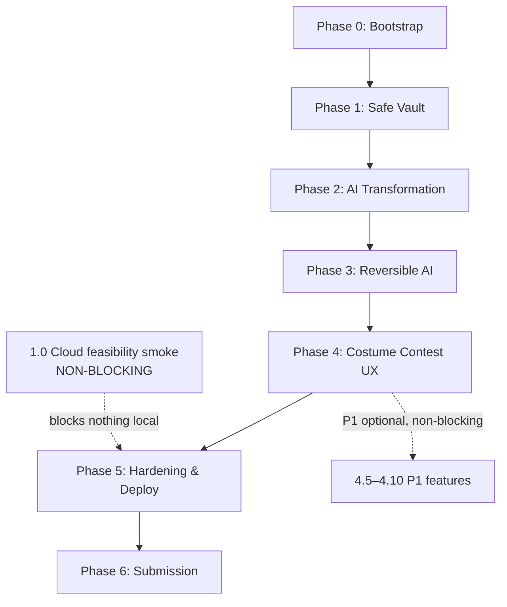

# Implementation Plan: Screenshot Graveyard

## Overview

This plan converts the Screenshot Graveyard design into a sequence of incremental, code-only tasks for a code-generation LLM. Each task builds on earlier tasks and ends with real integration, so there is no orphaned code. The stack is fixed by the design: React + TypeScript + Vite frontend, Python + FastAPI backend, SQLAlchemy 2.x + Alembic, Pydantic, Pillow, Hypothesis, pytest. (The design uses a concrete stack, not pseudocode, so no implementation-language choice is required.)

### How to read a task

Every leaf task carries:

- A short imperative description of code to write, modify, or test.
- **Dependencies:** prerequisite leaf-task IDs that must complete first, or `none`.
- **Requirements:** the mapped requirement sub-clauses, the relevant invariants (INV-1…INV-10), and the design Correctness Properties (P1…P28) it realizes, where relevant.
- **Acceptance test / expected output:** the concrete, automated signal that the task is done (what test runs and what it asserts, or the exact observable output).
- **Priority:** P0 (must-have), P1 (optional, non-blocking), or P2 (non-goal guardrail — not built).
- Major (top-level) tasks additionally carry a **Learn:** line naming the skill or concept the task exercises.

### The hard priority rule

- **No P1 task is ever a dependency of a P0 task.** P0 is fully shippable without any P1 work.
- **P1 work appears only in Phase 4 and later**, and every P1 leaf is tagged `[P1 — optional, non-blocking]`.
- The external-write properties **P27 / P28 (INV-8 / INV-9)** are **P1-conditional** per Req 14.7. In P0 the `Delivery_Service` is an **interface stub only** — method signatures and the external-write safety contract exist, but there is no implementation, no OAuth, and no third-party infrastructure. PBT-DELIVERY is exercised only when the P1 external integration is enabled, and is never required for P0 completion.

### P2 non-goals guardrail (reminder — NOT in this plan)

The following are explicitly out of scope (Req 17) and MUST NOT appear as tasks: automatic screenshot clustering; advanced reminders or scheduling; price tracking; persistent personalization from corrections; screenshot-region annotation; multiple external integrations; phone photo-library background syncing; permanent deletion of originals or device images; a password / plaintext-credential vault; automated purchases; a large autonomous-agent framework. Multi-user account authentication is also out of scope — per-visitor Workspace isolation is used instead.

### Grouped property-based test modules

Property-based tests use **Hypothesis** (backend; do not hand-roll PBT) and run **≥100 iterations**. Each test is tagged:

```
# Feature: screenshot-graveyard, Property {n}: {property_text}
```

The properties are grouped into these reusable modules:

- **PBT-STORAGE** — P1, P3, P4, P5, P6, P9, P10, P11 (source immutability; persisted checksum = content hash; per-workspace content-addressed dedup; extension-independent acceptance policy; decompression-bomb rejection; exclusive concurrency-safe write-once; crash-safe cleanup that never touches published originals; exclusive-create never overwrites). Enforces INV-1, INV-3, INV-10. **Required P0.**
- **PBT-LIFECYCLE** — P2, P8 (archive→restore round-trip with SHA-256 equality and return to active; stable Screenshot ID). Enforces INV-2, INV-3, INV-10. **Required P0.**
- **PBT-AI** — P12, P13, P14 (schema-validation gate; uncertainty represented not forced to success; atomic co-persistence of classification + Epitaph from one AI call). Enforces INV-1, INV-4. **Required P0.**
- **PBT-VERSIONING** — P15, P16, P17 (append-only versioning with all priors retained, including concurrent completion of Redo+Edit and Redo+Redo; provenance survives versions/redo; version compare). Enforces INV-5, INV-6, INV-7. **Required P0.**
- **PBT-STUDYNOTE** — P18, P19, P20, P21 (study-note structure completeness; faithful code preservation; selection count policy; Markdown export reflects the selected retained version).
- **PBT-ISOLATION** — P22, P23, P24, P25, P26 (operation status lifecycle; consent gate; workspace isolation + 404 existence non-disclosure; no secrets in logs; metaphor ↔ real state). Enforces INV-1, INV-4, INV-10. **Required P0 (P24 seeded early).**
- **PBT-DELIVERY** `[P1 — optional, non-blocking]` — P27, P28 (external write never reported successful without evidence; uncertain retries never duplicate), enforcing INV-8 / INV-9. Exercised only when the P1 external integration is enabled (Req 14.7); **never required for P0.**

## Tasks

### Phase 0 — November 4 (today): Project bootstrap & deploy-feasibility (P0)

- [x] 0.1 Scaffold the React + TypeScript + Vite frontend
  - Create the frontend app with Vite (React-TS template), ESLint + Prettier, and Vitest + Testing Library.
  - Add single-command `test` and `dev` scripts to `package.json`.
  - **Learn:** frontend toolchain bootstrap and a runnable component test harness.
  - **Dependencies:** none
  - **Requirements:** 11.1, 14.1
  - **Acceptance test / expected output:** a real minimal Vitest test renders an `App` component (or asserts a trivial truth inside a mounted component) and passes via `npm test -- --run`; `npm run build` succeeds. NOT an empty suite. *(CORRECTION 5)*
  - **Priority:** P0

- [x] 0.2 Scaffold the Python + FastAPI backend
  - Create the backend with FastAPI, uvicorn, SQLAlchemy 2.x, Alembic, Pydantic, Pillow, Hypothesis, and pytest, all pinned to explicit versions.
  - Define an app factory entrypoint and a single-command `pytest` script.
  - **Learn:** backend toolchain bootstrap with pinned deps and an importable app factory.
  - **Dependencies:** none
  - **Requirements:** 13.1, 14.1
  - **Acceptance test / expected output:** a real minimal pytest (e.g. asserts the importable app factory returns a FastAPI app, or a trivial unit test) runs and passes via `pytest`. NOT an empty suite; needs no network. *(CORRECTION 5)*
  - **Priority:** P0

- [x] 0.3 Implement `GET /api/health`
  - Add a health route returning `200 {"status":"ok"}` with no auth and no DB access.
  - **Dependencies:** 0.2
  - **Requirements:** 14.1, 15.1
  - **Acceptance test / expected output:** a pytest client call to `/api/health` returns `200` and body `{"status":"ok"}`.
  - **Priority:** P0

- [x] 0.4 Serve the SPA same-origin and wire a real frontend→backend call
  - Serve the built SPA from the FastAPI app at the same origin as `/api`.
  - Add a frontend call to `/api/health` that renders the result in the UI.
  - **Dependencies:** 0.1, 0.3
  - **Requirements:** 12.2 (same-origin boundary), 15.1
  - **Acceptance test / expected output:** a Vitest test mocks `/api/health` and asserts the rendered component shows the health status; a backend test asserts the SPA entry is served from the app origin.
  - **Priority:** P0

- [x] 0.5 Create `.kiro/steering/product.md`
  - Document product purpose, the three pillars, and the explicit non-goals.
  - **Dependencies:** none
  - **Requirements:** 15.8
  - **Acceptance test / expected output:** file exists at `.kiro/steering/product.md` and names the three pillars and the P2 non-goals.
  - **Priority:** P0

- [x] 0.6 Create `.kiro/steering/architecture.md`
  - Document the layered backend, same-origin deployment, DB + private file volume split, and the AIAdapter boundary.
  - **Dependencies:** none
  - **Requirements:** 15.8
  - **Acceptance test / expected output:** file exists at `.kiro/steering/architecture.md` and describes the middleware→router→service→repository/file-store layering.
  - **Priority:** P0

- [x] 0.7 Create `.kiro/steering/safety.md`
  - Enumerate INV-1 through INV-10 with one line each.
  - **Dependencies:** none
  - **Requirements:** 15.8
  - **Acceptance test / expected output:** file exists at `.kiro/steering/safety.md` and lists all ten invariants INV-1…INV-10.
  - **Priority:** P0

- [x] 0.8 Create development docs and repo hygiene files
  - Add `docs/kiro-development-log.md`, a README dev section, and a `.gitignore`.
  - **Dependencies:** none
  - **Requirements:** 15.7, 15.8
  - **Acceptance test / expected output:** `docs/kiro-development-log.md`, a README with a dev section, and `.gitignore` all exist in the repo.
  - **Priority:** P0

- [x] 0.9 First reviewed commit (describe only — do NOT commit)
  - Describe the intended first commit contents and message; do not execute any git commit as part of this planning workflow.
  - **Dependencies:** 0.1, 0.2, 0.3, 0.4, 0.5, 0.6, 0.7, 0.8
  - **Requirements:** 15.6
  - **Acceptance test / expected output:** a written description of the commit scope and message exists; no commit is performed.
  - **Priority:** P0

### Phase 1 — November 5–7: Safe Vault (P0)

- [ ] 1.0 Early cloud persistence feasibility smoke deploy (NON-BLOCKING)
  - Relocated from Phase 0 to run as an early, parallel, **non-blocking** track in Phase 1. *(CORRECTION 1)*
  - Smoke-deploy to a solo-dev PaaS (Fly.io preferred; Render/Railway fallback) with a persistent volume + managed Postgres; a probe writes one Postgres row and one byte file, restart the instance, then verify both survive.
  - **Rationale:** prove the persistent volume + managed Postgres survive a restart before the product relies on production storage.
  - **NON-BLOCKING NOTE:** no local task depends on 1.0. Local Phase 0 scaffolding (0.1–0.9) and all Safe Vault tasks (1.1–1.16) are implementable and testable locally with **no** dependency on a successful cloud deploy. *(CORRECTION 1)*
  - **Dependencies:** none
  - **Requirements:** 15.1, 15.2, 2.3, 12.4 (feasibility only; final deployed-product verification is Phase 5)
  - **Acceptance test / expected output:** after a restart of the smoke instance, the probe Postgres row and the probe byte file are both still present. This is a feasibility smoke test, distinct from the Phase 5 deployed-product verification.
  - **Priority:** P0

- [x] 1.1 Create the DB schema and Alembic migrations
  - Define all tables (`workspace`, `content_blob`, `screenshot`, `artifact`, `artifact_version`, `source_reference`, `consent_record`, `operation`) with the UNIQUE constraints and `workspace_id` FK + index on every non-`workspace` table.
  - **Learn:** SQLAlchemy 2.x models + Alembic migrations with constraint-backed integrity.
  - **Dependencies:** 0.2
  - **Requirements:** 12.1, 12.3, 12.6, 2.4 (`UNIQUE(workspace_id, sha256)`), 7.3/7.5 (`UNIQUE(artifact_id, version_number)`), 9.9
  - **Acceptance test / expected output:** a migration test creates the schema from zero and asserts each table, each UNIQUE constraint, and each `workspace_id` index exists.
  - **Priority:** P0

- [x] 1.2 Implement the workspace-scoped repository layer
  - Add repository methods for every table; every method requires an explicit `workspace_id` argument with no unscoped query path.
  - **Dependencies:** 1.1
  - **Requirements:** 12.6, 9.9, 9.10
  - **Acceptance test / expected output:** repository unit tests assert that reads/writes are filtered by `workspace_id` and that there is no method exposing cross-workspace rows.
  - **Priority:** P0

- [x] 1.3 Implement workspace identity middleware
  - Mint `secrets.token_urlsafe(32)` on first visit; store only `sha256(token)`; set an `HttpOnly; Secure; SameSite=Strict; Path=/` cookie; resolve `workspace_id` server-side; provide no token-bearing recovery URL.
  - **Learn:** cookie-based anonymous identity with hash-only server storage.
  - **Dependencies:** 1.2
  - **Requirements:** 9.9, 12.6, 15.3
  - **Acceptance test / expected output:** middleware tests assert the token is 32-byte url-safe, only the hash is persisted, lookup is by hash, the cookie flags are set, and no path/body workspace id is honored.
  - **Priority:** P0

- [x] 1.4 Implement three-layer CSRF/Origin middleware
  - Enforce `SameSite=Strict` cookie + server-side Origin/Referer check + required `X-Requested-With` header on state-changing methods; return `403` on violation.
  - **Dependencies:** 1.3
  - **Requirements:** 9.9
  - **Acceptance test / expected output:** router tests assert a state-changing request with a foreign `Origin` or missing custom header is rejected with `403`, and a same-origin request with the header passes.
  - **Priority:** P0

- [x] 1.5 Implement the in-process rate limiter and size/quota gates
  - Add a per-workspace token-bucket limiter, per-workspace DB quota counters, a max-files-per-batch cap, and a payload size gate enforced **before** buffering the whole body.
  - **Dependencies:** 1.3
  - **Requirements:** 1.5 (size gate), 15.* (public-deployment protection)
  - **Acceptance test / expected output:** unit test on the token bucket; router test asserts `413` past the size cap (before full buffering) and `429` past the rate limit.
  - **Priority:** P0

- [x] 1.6 Implement the write-once content-addressed file store
  - Provide `write_once` / `read` / `exists` only (no delete, no overwrite); temp files in a reserved `.tmp/`; `flush()` + `os.fsync()`; publish by exclusive `os.link` / `open(O_CREAT|O_EXCL)`; set published files `0o444`; `try/finally` temp cleanup.
  - **Learn:** OS-level exclusive-create publication and crash-safe temp handling.
  - **Dependencies:** 0.2  *(CORRECTION 2 — depends only on 0.2; NOT on the cloud feasibility task 1.0)*
  - **Requirements:** 2.1, 12.2, INV-1, INV-3, INV-10, P9, P10, P11
  - **Acceptance test / expected output:** unit/integration tests (local, no deployment) assert exclusive-create fails on an existing path without replacing bytes, published files are `0o444`, and in-process failures remove the temp file.
  - **Priority:** P0

- [x] 1.7 Implement upload validation (content-authoritative policy)
  - Enforce the ordered policy: size gate before decode; file signature; Pillow `verify()` + load; ≈40 MP / 12000 px cap; treat extension/MIME as hints only; on mismatch accept and persist the detected true format.
  - **Dependencies:** 0.2
  - **Requirements:** 1.2, 1.3, 1.4, 1.5, INV-1, P5, P6
  - **Acceptance test / expected output:** tests assert accept = signature + decode + caps + size independent of declared extension/MIME, a mismatched-but-valid image is accepted with the detected format persisted, and a decompression bomb is rejected by the pixel cap.
  - **Priority:** P0

- [x] 1.8 Implement `Vault_Service` upload: validate → dedup → write-once → persist
  - Orchestrate validation, per-workspace blob dedup by SHA-256, write-once storage, and metadata persistence; assign a stable Screenshot ID; persist checksum + detected mime; flag duplicate upload records. `Vault_Service` is the only importer of the file store.
  - **Dependencies:** 1.6, 1.7, 1.2
  - **Requirements:** 1.7, 2.1, 2.2, 2.4, 2.5, INV-1, INV-3, P3, P4, P8
  - **Acceptance test / expected output:** service tests assert one `content_blob` per identical content with a distinct `screenshot` per upload, persisted checksum equals the content hash, and duplicates are flagged.
  - **Priority:** P0

- [x] 1.9 Implement the upload router with mixed-batch partial success
  - Accept multiple files; store valid ones; report per-file errors for invalid ones; return `207 Multi-Status` for mixed batches without aborting.
  - **Dependencies:** 1.8, 1.4, 1.5
  - **Requirements:** 1.1, 1.6, P7
  - **Acceptance test / expected output:** router test uploads a mixed batch and asserts `207`, valid files stored, each invalid file reported by name.
  - **Priority:** P0

- [x] 1.10 Implement Archive (Safe Burial) and Restore (Resurrection) with SHA-256 verification
  - Archive moves a screenshot to The Crypt retaining bytes + checksum; restore returns it to active and verifies SHA-256; on mismatch report `failed` and retain archived bytes; no delete path.
  - **Dependencies:** 1.8
  - **Requirements:** 3.1, 3.2, 3.3, 3.4, 3.5, 3.6, 2.6, INV-2, INV-3, INV-4, INV-10, P2
  - **Acceptance test / expected output:** service tests assert archive→restore returns to active with matching SHA-256, a forced mismatch reports `failed` with bytes retained, and no permanent-delete path exists.
  - **Priority:** P0

- [x] 1.11 Implement the authorized image-read endpoint
  - Serve image bytes only through a workspace-scoped, authorization-checked API endpoint; a foreign-workspace read returns `404`; bytes are never static/public.
  - **Dependencies:** 1.8, 1.3
  - **Requirements:** 9.10, 12.2, 12.6, P24
  - **Acceptance test / expected output:** router tests assert an owner read returns bytes `200`, a foreign-workspace read returns `404`, and no public/static path serves the bytes.
  - **Priority:** P0

- [x] 1.12 Build the early Halloween UI foundation
  - Scaffold Ghost (pending) and Crypt (archived) views mapped to real state, plus a duplicate indicator, on top of the upload/archive flows.
  - **Dependencies:** 1.9, 1.10, 1.11
  - **Requirements:** 10.1, 10.2, 2.5, 10.6
  - **Acceptance test / expected output:** Vitest tests assert the Ghost renders for pending screenshots, the Crypt lists archived screenshots, and the duplicate indicator renders for a duplicate record.
  - **Priority:** P0

- [x] 1.13 Write the PBT-STORAGE module (REQUIRED)
  - Implement Properties P1, P3, P4, P5, P6, P9, P10, P11 with Hypothesis ≥100 iterations, each tagged with its property line. *(CORRECTION 3 — REQUIRED, non-optional: covers source immutability P1.)*
  - **Dependencies:** 1.6, 1.7, 1.8
  - **Requirements:** 1.2, 1.3, 1.4, 1.5, 2.1, 2.2, 2.4, INV-1, INV-3, INV-10, P1, P3, P4, P5, P6, P9, P10, P11
  - **Acceptance test / expected output:** all PBT-STORAGE properties pass ≥100 iterations, including concurrent identical uploads and the crash-safe sweep that never modifies a published original.
  - **Priority:** P0

- [x] 1.14 Write the PBT-LIFECYCLE module (REQUIRED)
  - Implement Properties P2 and P8 with Hypothesis ≥100 iterations. *(CORRECTION 3 — REQUIRED, non-optional: covers SHA-256 archive/restore round-trip P2.)*
  - **Dependencies:** 1.10
  - **Requirements:** 3.1, 3.2, 3.3, 14.2, 1.7, INV-2, INV-3, INV-10, P2, P8
  - **Acceptance test / expected output:** archive→restore yields bytes whose SHA-256 equals the stored checksum and returns to active; the Screenshot ID is stable across operations; ≥100 iterations.
  - **Priority:** P0

- [x] 1.15 Seed the PBT-ISOLATION module with workspace isolation (REQUIRED)
  - Implement Property P24 for screenshots and image bytes (foreign workspace → `404`, data unchanged) with Hypothesis ≥100 iterations. *(CORRECTION 3 — REQUIRED, non-optional: covers workspace isolation P24.)*
  - **Dependencies:** 1.11
  - **Requirements:** 9.9, 9.10, 12.6, INV-1, INV-10, P24
  - **Acceptance test / expected output:** for any resource created in workspace A, every read/mutate from workspace B returns `404` and leaves A's data unchanged; ≥100 iterations.
  - **Priority:** P0

- [x] 1.16 Checkpoint — ensure all tests pass
  - Ensure all tests pass, ask the user if questions arise.
  - **Dependencies:** 1.12, 1.13, 1.14, 1.15
  - **Requirements:** 14.1
  - **Acceptance test / expected output:** the full suite runs green via the single-command test scripts.
  - **Priority:** P0

### Phase 2 — November 8–13: AI Transformation (P0)

- [x] 2.1 Define the `AIAdapter` Protocol and Pydantic result schemas
  - Define `classify_and_epitaph` and `study_note` methods, `ClassificationResult` / `StudyNoteResult` Pydantic models, and an adapter timeout.
  - **Learn:** isolating a swappable AI boundary behind one validated Protocol.
  - **Dependencies:** 0.2
  - **Requirements:** 13.1, 13.2, 13.4, P12
  - **Acceptance test / expected output:** a contract test asserts the Protocol methods and schemas exist and that well-formed sample output validates against the Pydantic models.
  - **Priority:** P0

- [x] 2.2 Implement the `fake_adapter`
  - Deterministic adapter returning schema-valid output, with switches to simulate invalid output, timeouts, and uncertainty.
  - **Dependencies:** 2.1
  - **Requirements:** 13.4, P12, P13
  - **Acceptance test / expected output:** tests assert default output validates, and the invalid/timeout/uncertain modes produce the corresponding simulated results.
  - **Priority:** P0

- [x] 2.3 Implement `Consent_Service` and the consent gate
  - Record/read per-screenshot consent; block AI paths with `403` and never call the adapter without consent; store/archive/restore still work without consent.
  - **Dependencies:** 1.2, 2.1
  - **Requirements:** 9.2, 9.4, P23
  - **Acceptance test / expected output:** tests assert an AI call without consent returns `403` and the adapter is never invoked, while vault operations still succeed with bytes intact.
  - **Priority:** P0

- [x] 2.4 Implement the operation lifecycle with async 202 + poll
  - Create `operation` records; AI endpoints return `202` + `operationId`; `GET /api/operations/{id}` reports `pending`/`successful`/`failed`/`uncertain`; `successful` only after the persistence commit.
  - **Dependencies:** 1.2, 2.1
  - **Requirements:** 8.2, 8.3, P22
  - **Acceptance test / expected output:** tests assert the status is always one of the four values, is observable via the poll endpoint, and transitions to `successful` only post-commit.
  - **Priority:** P0

- [x] 2.5 Implement `Classification_Service` with atomic co-persistence
  - Make one AI call; persist classification + Epitaph in a single transaction (or full rollback); invalid/uncertain → `failed`/`uncertain` with sources untouched; allow edit/override as new versions; treat Potentially Sensitive as advisory.
  - **Dependencies:** 2.2, 2.3, 2.4
  - **Requirements:** 4.1, 4.2, 4.3, 4.4, 4.5, 4.7, 5.1, 5.3, INV-1, INV-4, P12, P13, P14
  - **Acceptance test / expected output:** tests assert exactly one adapter call, classification and Epitaph committed together or not at all, schema failure → `failed` with sources unchanged, and Potentially Sensitive surfaced as advisory.
  - **Priority:** P0

- [ ] 2.6 Implement manual study-screenshot selection and the count policy
  - Require manual selection; accept 1–12; warn (non-blocking) outside 4–8; reject `<1` or `>12` with a descriptive error.
  - **Dependencies:** 1.2
  - **Requirements:** 6.1, 6.2, 6.3, P20
  - **Acceptance test / expected output:** tests assert counts 1 and 12 accepted, 0 and 13 rejected, and the non-blocking warning present exactly when count `<4` or `>8`.
  - **Priority:** P0

- [ ] 2.7 Implement `Study_Note_Service` generation
  - Generate all required sections; preserve code faithfully; flag uncertainty; record `source_reference` to each Screenshot ID; persist version 1 atomically; never modify source bytes.
  - **Dependencies:** 2.2, 2.3, 2.4, 2.6
  - **Requirements:** 6.4, 6.5, 6.6, 6.7, 6.12, INV-1, INV-7, P16, P18, P19
  - **Acceptance test / expected output:** tests assert all sections present, extracted code preserved character-for-character, source references recorded, and source bytes unchanged.
  - **Priority:** P0

- [ ] 2.8 Implement study-note edit, reopen-original, and Markdown export
  - Save edits as new versions; let the user reopen each referenced original; export valid Markdown (mandatory P0) reflecting the selected retained version, defaulting to current.
  - **Dependencies:** 2.7
  - **Requirements:** 6.8, 6.9, 6.11, P21
  - **Acceptance test / expected output:** tests assert an edit creates a new retained version, each referenced original is reopenable, and export produces valid Markdown for the selected/current version.
  - **Priority:** P0

- [ ] 2.9 Implement the startup stale-pending sweep and adapter-timeout handling
  - Run AI work in non-durable `BackgroundTasks`; on startup/periodically mark stale `pending` operations `failed`; handle adapter timeouts; leave sources intact.
  - **Dependencies:** 2.4, 2.5
  - **Requirements:** 8.1, 8.2, 8.3, INV-4, P22, P13
  - **Acceptance test / expected output:** tests simulate a crash mid-operation and a timeout and assert the sweep marks the operation `failed`/`uncertain` with sources intact.
  - **Priority:** P0

- [ ] 2.10 Build the AI UX
  - Show the privacy warning before analysis; require explicit consent before sending bytes; provide Revive; show status via text + non-color cues; allow editing category/Epitaph; provide study-note selection/view/export.
  - **Dependencies:** 2.5, 2.8, 2.9, 1.12
  - **Requirements:** 9.1, 9.3, 10.3, 11.5, 4.5, 5.5, 6.8
  - **Acceptance test / expected output:** Vitest tests assert the privacy warning precedes analysis, consent is required before any send, status is conveyed without relying on color, and category/Epitaph are editable.
  - **Priority:** P0

- [ ] 2.11 Write the PBT-AI module and complete PBT-ISOLATION (REQUIRED)
  - Implement Properties P12, P13, P14 (PBT-AI) and complete PBT-ISOLATION parts P22, P23, P25 (and P24 beyond the Phase 1 seed) with Hypothesis ≥100 iterations. *(CORRECTION 3 — REQUIRED, non-optional: covers failure safety via status/preserve-on-failure and the consent gate.)*
  - **Dependencies:** 2.5, 2.6, 2.7, 2.8, 2.9, 1.15
  - **Requirements:** 4.1, 4.2, 4.4, 5.1, 5.3, 8.2, 8.3, 9.2, 9.4, 9.8, INV-1, INV-4, P12, P13, P14, P22, P23, P24, P25
  - **Acceptance test / expected output:** PBT-AI and the completed PBT-ISOLATION properties pass ≥100 iterations each, including the schema gate, uncertainty representation, atomic co-persistence, consent gate, status lifecycle, and no-secrets-in-logs.
  - **Priority:** P0

- [ ] 2.12 Checkpoint — ensure all tests pass
  - Ensure all tests pass, ask the user if questions arise.
  - **Dependencies:** 2.10, 2.11
  - **Requirements:** 14.1
  - **Acceptance test / expected output:** the full suite runs green via the single-command test scripts.
  - **Priority:** P0

### Phase 3 — November 14–19: Resurrection / Reversible AI (P0)

- [ ] 3.1 Implement append-only artifact versions
  - INSERT-only `artifact_version` with `UNIQUE(artifact_id, version_number)` and no UPDATE path to `content_json`; maintain the `current_version_id` pointer.
  - **Learn:** append-only history with a current-version pointer.
  - **Dependencies:** 1.1, 2.5
  - **Requirements:** 7.3, 7.5, INV-5, INV-6, P15
  - **Acceptance test / expected output:** tests assert versions are insert-only, version numbers are strictly increasing with no gaps/duplicates, and there is no code path that updates `content_json`.
  - **Priority:** P0

- [ ] 3.2 Implement manual Edit versions
  - A saved Manual Edit creates a new version and never overwrites a prior saved version.
  - **Dependencies:** 3.1
  - **Requirements:** 7.4, 6.9, INV-5, INV-6, P15
  - **Acceptance test / expected output:** tests assert a saved edit inserts a new version and all prior versions remain retrievable.
  - **Priority:** P0

- [ ] 3.3 Implement AI Redo
  - An AI Redo creates a new version, never discards a manual edit, and allows modifiable regeneration instructions.
  - **Dependencies:** 3.1, 2.5
  - **Requirements:** 7.3, 7.6, 7.7, 6.10, INV-5, INV-6, P15
  - **Acceptance test / expected output:** tests assert a Redo after a manual edit retains the edited version separately and honors modified regeneration instructions.
  - **Priority:** P0

- [ ] 3.4 Implement version comparison
  - Retrieve any two retained versions and produce a comparison.
  - **Dependencies:** 3.1
  - **Requirements:** 7.8, INV-6, P17
  - **Acceptance test / expected output:** tests assert any two versions can be retrieved and compared (e.g. v1 vs v2).
  - **Priority:** P0

- [ ] 3.5 Ensure source references survive versions and redo
  - Keep `source_reference` attached to the artifact so provenance is unchanged by any Redo or Manual Edit.
  - **Dependencies:** 3.2, 3.3
  - **Requirements:** 7.2, 6.7, 12.3, INV-7, P16
  - **Acceptance test / expected output:** tests assert that after any sequence of redos/edits, the artifact still references every source Screenshot ID.
  - **Priority:** P0

- [ ] 3.6 Implement failure recovery for versioned operations
  - Persist each success as one atomic transaction; an error after a valid AI response but before commit → `failed`/retryable; a safe retry creates a new operation and a new version.
  - **Dependencies:** 3.1, 2.9
  - **Requirements:** 8.1, 8.6, INV-4, INV-5, INV-6, P15, P22
  - **Acceptance test / expected output:** tests assert a pre-commit failure rolls back with no partial version and that a retry yields a new operation + new version with priors retained.
  - **Priority:** P0

- [ ] 3.7 Implement and test concurrent operation completion
  - Use optimistic insert + unique-constraint + bounded retry-on-conflict so concurrent Redo + Manual Edit and Redo + Redo on the same artifact **both complete** with distinct version numbers, all priors retained, and a valid `current_version_id`.
  - **Dependencies:** 3.2, 3.3
  - **Requirements:** 7.3, 7.4, 7.5, 7.6, 14.3, INV-5, INV-6, P15
  - **Acceptance test / expected output:** a threaded test issues concurrent Redo+Edit (and Redo+Redo) and asserts both commit, version count rises by the number of operations, version numbers are distinct, priors retrievable, and `current_version_id` is valid.
  - **Priority:** P0

- [ ] 3.8 Write the PBT-VERSIONING module (REQUIRED)
  - Implement Properties P15, P16, P17 with Hypothesis ≥100 iterations, including the concurrent-completion case within P15. *(CORRECTION 3 — REQUIRED, non-optional: covers append-only versions P15 and provenance P16.)*
  - **Dependencies:** 3.4, 3.5, 3.6, 3.7
  - **Requirements:** 4.5, 5.5, 6.9, 6.10, 7.3, 7.4, 7.5, 7.6, 7.8, 8.6, 14.3, 14.4, INV-5, INV-6, INV-7, P15, P16, P17
  - **Acceptance test / expected output:** PBT-VERSIONING passes ≥100 iterations, including concurrent Redo+Edit / Redo+Redo both completing and provenance surviving every version.
  - **Priority:** P0

- [ ] 3.9 Checkpoint — ensure all tests pass
  - Ensure all tests pass, ask the user if questions arise.
  - **Dependencies:** 3.8
  - **Requirements:** 14.1
  - **Acceptance test / expected output:** the full suite runs green via the single-command test scripts.
  - **Priority:** P0

### Phase 4 — November 20–25: Costume Contest UX (P0 core; P1 optional only after P0 is stable)

- [ ] 4.1 Build The Crypt view and Ghost/Epitaph interactions
  - Implement the Crypt browsing view and Ghost/Epitaph interactions bound to real state.
  - **Learn:** mapping Halloween metaphors to concrete system states in the UI.
  - **Dependencies:** 1.12, 2.10
  - **Requirements:** 10.1, 10.2, 10.6, 5.5
  - **Acceptance test / expected output:** Vitest tests assert the Crypt shows exactly archived screenshots and Ghost/Epitaph controls reflect and edit the real underlying state.
  - **Priority:** P0

- [ ] 4.2 Implement the polished, memorable Resurrection experience (reduced-motion aware)
  - Present restore and AI Redo as Resurrection with a memorable but `prefers-reduced-motion`-aware animation.
  - **Dependencies:** 4.1, 3.3
  - **Requirements:** 10.4, 11.3
  - **Acceptance test / expected output:** Vitest tests assert the Resurrection flow runs and that reduced-motion disables/minimizes the animation.
  - **Priority:** P0

- [ ] 4.3 Implement responsive layouts
  - Ensure usable layouts across mobile, tablet, and desktop viewport widths.
  - **Dependencies:** 4.1
  - **Requirements:** 11.1
  - **Acceptance test / expected output:** Vitest tests assert key views render usably at representative mobile/tablet/desktop widths.
  - **Priority:** P0

- [ ] 4.4 Implement accessibility and reduced-motion controls
  - Provide keyboard operability, accessible names, status via text + non-color cues, contrast-checked typography, `prefers-reduced-motion` support, and an in-app reduced-motion toggle.
  - **Dependencies:** 4.1
  - **Requirements:** 11.2, 11.3, 11.4, 11.5, 10.5 (Safe Burial copy states bytes retained)
  - **Acceptance test / expected output:** Vitest/Testing Library tests assert controls have accessible names, are keyboard operable, status is conveyed without color alone, and the reduced-motion toggle plus OS preference both minimize animation.
  - **Priority:** P0

- [ ] 4.5 `[P1 — optional, non-blocking]` Shopping wishlist cards
  - Allow creating simple wishlist cards from Shopping/Inspiration screenshots.
  - **Dependencies:** 4.1
  - **Requirements:** 16.1
  - **Acceptance test / expected output:** tests assert a wishlist card can be created from a Shopping/Inspiration screenshot.
  - **Priority:** P1

- [ ] 4.6 `[P1 — optional, non-blocking]` Memories gallery
  - Present Memory/Entertainment screenshots in a gallery view.
  - **Dependencies:** 4.1
  - **Requirements:** 16.2
  - **Acceptance test / expected output:** tests assert the gallery shows exactly Memory/Entertainment screenshots.
  - **Priority:** P1

- [ ] 4.7 `[P1 — optional, non-blocking]` Quick Ritual review
  - Offer a time-boxed review (2-minute / 10-minute / all-items) with Revive, Let Rest, and Later actions; persist actions and allow undo.
  - **Dependencies:** 4.1
  - **Requirements:** 16.4, 16.5
  - **Acceptance test / expected output:** tests assert the three time boxes present the three actions, actions persist, and an action is undoable.
  - **Priority:** P1

- [ ] 4.8 `[P1 — optional, non-blocking]` Subtle themed animations tied to real state
  - Add subtle Halloween animations, each connected to a real workflow state and honoring reduced-motion.
  - **Dependencies:** 4.2, 4.4
  - **Requirements:** 16.6, 11.3
  - **Acceptance test / expected output:** tests assert each animation maps to a real state and is disabled/minimized under reduced-motion.
  - **Priority:** P1

- [ ] 4.9 `[P1 — optional, non-blocking]` Single external integration (OneNote preferred; Google Docs fallback)
  - Implement one genuine external destination via `Delivery_Service`, honoring INV-8/INV-9 (verified evidence before success; no blind duplicate on uncertain retry). Enables PBT-DELIVERY. No P0 task depends on this.
  - **Dependencies:** 2.8, 4.1
  - **Requirements:** 16.3, 8.4, 8.5, 14.6, 14.7, INV-8, INV-9, P27, P28
  - **Acceptance test / expected output:** with the integration enabled, tests assert a write is reported successful only with verified evidence and an uncertain retry does not create a duplicate external artifact.
  - **Priority:** P1

- [ ] 4.10 `[P1 — optional, non-blocking]` Write the PBT-DELIVERY module
  - Implement Properties P27, P28 with Hypothesis ≥100 iterations; exercised only when 4.9 is enabled; never required for P0.
  - **Dependencies:** 4.9
  - **Requirements:** 8.4, 8.5, 14.6, 14.7, 16.3, INV-8, INV-9, P27, P28
  - **Acceptance test / expected output:** when the integration is enabled, PBT-DELIVERY passes ≥100 iterations for both properties.
  - **Priority:** P1

- [ ] 4.11 Feature freeze — November 25 (milestone marker)
  - Mark the P0 feature freeze; no new P0 scope after this point.
  - **Dependencies:** 4.1, 4.2, 4.3, 4.4
  - **Requirements:** 15.* (submission readiness cadence)
  - **Acceptance test / expected output:** a freeze note is recorded in `docs/kiro-development-log.md`; P0 scope is closed.
  - **Priority:** P0

### Phase 5 — November 26–30: Hardening & deploy (P0)

- [ ] 5.1 Run the full regression and grouped PBT pass
  - Run all unit/integration tests and every required grouped PBT module at ≥100 iterations.
  - **Learn:** end-to-end suite hardening and property coverage verification.
  - **Dependencies:** 3.9, 4.11
  - **Requirements:** 14.1, 14.2, 14.3, 14.4, 14.5
  - **Acceptance test / expected output:** the complete suite, including PBT-STORAGE/LIFECYCLE/AI/VERSIONING/ISOLATION, passes green.
  - **Priority:** P0

- [ ] 5.2 Run crash and failure testing
  - Simulate a process crash mid-AI (sweep → `failed`) and an interrupted write (crash-safe temp cleanup that never touches a published original).
  - **Dependencies:** 5.1
  - **Requirements:** 8.1, 8.6, INV-1, INV-4, P10, P22
  - **Acceptance test / expected output:** tests assert the sweep recovers a mid-AI crash to `failed` with sources intact and an interrupted write leaves no published artifact and never modifies an original.
  - **Priority:** P0

- [ ] 5.3 Deploy the full application
  - Deploy the same-origin SPA + API with a persistent volume and managed Postgres; no ephemeral storage for originals.
  - **Dependencies:** 5.1
  - **Requirements:** 15.1, 15.2, 15.4, 12.2
  - **Acceptance test / expected output:** the full application is reachable at a public URL and serves both the SPA and `/api` from one origin with originals on the persistent volume.
  - **Priority:** P0

- [ ] 5.4 Verify production persistence of the deployed product
  - On the deployed product, restart the service and verify DB rows, byte files, and checksums all survive. Distinct from the Phase 1 feasibility smoke test (1.0). *(CORRECTION 4 — depends on the full-app deploy 5.3; no cycle.)*
  - **Dependencies:** 5.3
  - **Requirements:** 2.3, 12.4, 15.2, 15.4
  - **Acceptance test / expected output:** after restarting the deployed product, previously stored screenshots/artifacts/byte files are still present and checksums still verify.
  - **Priority:** P0

- [ ] 5.5 Run small usability sessions (synthetic/authorized content only)
  - Exercise the deployed flows using only synthetic or authorized screenshots and record findings as code-fixable issues.
  - **Dependencies:** 5.3
  - **Requirements:** 15.10, 9.* (no real private content)
  - **Acceptance test / expected output:** a short findings list is recorded in `docs/kiro-development-log.md`; only synthetic/authorized content was used.
  - **Priority:** P0

- [ ] 5.6 Run full end-to-end testing
  - Execute automated end-to-end tests across upload → classify → study note → redo → archive/restore on the deployed-equivalent build.
  - **Dependencies:** 5.3, 5.4
  - **Requirements:** 14.1, 15.3, 15.4
  - **Acceptance test / expected output:** the automated end-to-end suite passes against the deployed-equivalent build with workspace isolation in effect.
  - **Priority:** P0

### Phase 6 — December 1–2: Submission (P0 deliverables)

- [ ] 6.1 Finalize the English README
  - Write a complete English README covering setup, usage, architecture, and the live URL.
  - **Learn:** submission-grade documentation.
  - **Dependencies:** 5.3
  - **Requirements:** 15.7
  - **Acceptance test / expected output:** `README.md` is in English and documents setup, usage, and the public URL.
  - **Priority:** P0

- [ ] 6.2 Finalize development documentation and Kiro evidence
  - Complete `docs/kiro-development-log.md` and include real Kiro implementation evidence.
  - **Dependencies:** 5.6
  - **Requirements:** 15.8
  - **Acceptance test / expected output:** `docs/kiro-development-log.md` is complete and includes Kiro implementation evidence.
  - **Priority:** P0

- [ ] 6.3 Validate the public GitHub repository and LICENSE
  - Ensure the repo is public, contains a root `.kiro` directory, and includes an open-source LICENSE.
  - **Dependencies:** 6.1
  - **Requirements:** 15.6, 15.7
  - **Acceptance test / expected output:** the repository is public with a root `.kiro` directory and an open-source `LICENSE` file present.
  - **Priority:** P0

- [ ] 6.4 Produce the public YouTube demo (< 3 min, synthetic/authorized content)
  - Record and publish a public demo video under 3 minutes using only synthetic or authorized content.
  - **Dependencies:** 5.6
  - **Requirements:** 15.9, 15.10
  - **Acceptance test / expected output:** a public YouTube link under 3 minutes exists and uses only synthetic/authorized screenshots.
  - **Priority:** P0

- [ ] 6.5 Complete the Devpost submission
  - Fill out the complete Devpost submission and note student-bonus eligibility; record the key deadlines (submission December 4, 2:00 PM Pacific; keep the deployment live through January 29, 2027).
  - **Dependencies:** 6.1, 6.2, 6.3, 6.4
  - **Requirements:** 15.9, 15.2
  - **Acceptance test / expected output:** the Devpost submission is complete with links to the repo, live URL, and demo; deadlines and student-bonus details are recorded.
  - **Priority:** P0

## Notes

- Tasks tagged `[P1 — optional, non-blocking]` (4.5–4.10) are optional and never block any P0 task; they appear only in Phase 4+.
- PBT modules covering the mandatory P0 invariants — PBT-STORAGE (1.13), PBT-LIFECYCLE (1.14), PBT-ISOLATION seed (1.15), PBT-AI + ISOLATION completion (2.11), and PBT-VERSIONING (3.8) — are **REQUIRED** non-optional checkboxes. *(CORRECTION 3)*
- PBT-DELIVERY (P27/P28, INV-8/INV-9) remains `[P1 — optional, non-blocking]` and is exercised only when the external integration (4.9) is enabled (Req 14.7).
- Task 1.0 (cloud feasibility smoke) is early but **non-blocking**; nothing local depends on it. *(CORRECTION 1)*
- Task 1.6 (write-once file store) depends only on 0.2 and is fully testable locally. *(CORRECTION 2)*
- Phase 5 verification (5.4) depends on the full-app deploy (5.3) — deploy first, then verify — and is distinct from the 1.0 feasibility smoke. *(CORRECTION 4)*
- Each task references specific requirement sub-clauses, invariants, and design properties for traceability.
- P2 non-goals (Req 17) are intentionally absent from the task list.

## Task Dependency Graph

### Phase-level graph (mermaid)



Notes on the phase graph:

- 1.0 is drawn as a detached, non-blocking track; no local task depends on it, and it is distinct from the Phase 5 deployed-product verification (5.4).
- The P1 optional features (4.5–4.10) branch off Phase 4 and never feed back into any P0 task.

### Leaf-task parallel-wave summary

Each wave runs after all earlier waves complete; tasks within a wave are independent and may run in parallel. Optional P1 leaves are included but never gate P0 waves. *(CORRECTION 6)*

```json
{
  "waves": [
    { "id": 0, "tasks": ["0.1", "0.2", "0.5", "0.6", "0.7", "0.8", "1.0"] },
    { "id": 1, "tasks": ["0.3", "1.1", "1.6", "1.7", "2.1"] },
    { "id": 2, "tasks": ["0.4", "0.9", "1.2", "2.2"] },
    { "id": 3, "tasks": ["1.3", "1.5", "1.8"] },
    { "id": 4, "tasks": ["1.4", "1.10", "1.11", "2.6"] },
    { "id": 5, "tasks": ["1.9", "1.13", "1.14", "1.15", "2.3", "2.4"] },
    { "id": 6, "tasks": ["1.12", "2.5"] },
    { "id": 7, "tasks": ["2.7", "3.1"] },
    { "id": 8, "tasks": ["2.8", "2.9", "3.2", "3.3", "3.4"] },
    { "id": 9, "tasks": ["2.10", "3.5", "3.6", "3.7"] },
    { "id": 10, "tasks": ["2.11", "3.8"] },
    { "id": 11, "tasks": ["4.1"] },
    { "id": 12, "tasks": ["4.2", "4.3", "4.4", "4.5", "4.6", "4.7"] },
    { "id": 13, "tasks": ["4.8", "4.9"] },
    { "id": 14, "tasks": ["4.10", "5.1"] },
    { "id": 15, "tasks": ["5.2", "5.3"] },
    { "id": 16, "tasks": ["5.4", "5.5"] },
    { "id": 17, "tasks": ["5.6", "6.1"] },
    { "id": 18, "tasks": ["6.2", "6.3", "6.4"] },
    { "id": 19, "tasks": ["6.5"] }
  ]
}
```

Wave guarantees (CORRECTION 6):

- No task appears in a wave earlier than any of its dependencies, and no task depends on itself.
- 1.0 (cloud feasibility) is in wave 0 and gates nothing local.
- 1.6 (write-once store) is in wave 1 and depends only on 0.2 (wave 0).
- 5.4 (production persistence verification) is in wave 16, after 5.3 (full deploy) in wave 15 — deploy precedes verify, no cycle.
- Every P1 leaf (4.5–4.10) sits in a wave at or after its P0 prerequisites and never appears as a dependency of any P0 task.
